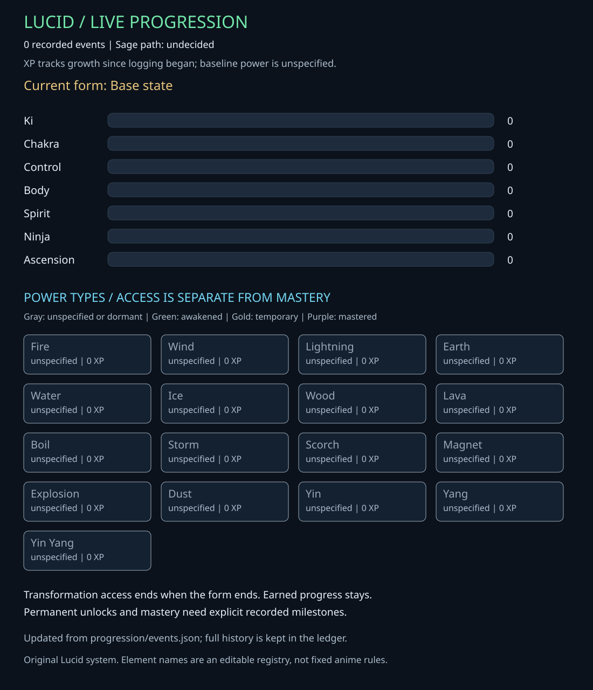

# LUCID

Original comic universe and character progression.

## Current power graph



[Full progression history](progression/README.md) · [Power system rules](docs/power-system.md)

Original visual references: [ki flow](docs/reference/Lucid-Ki-Flow.png), [chakra elements](docs/reference/Lucid-Chakra-Chart.png), and [both charts as PDF](docs/reference/Lucid-Ki-and-Chakra-Charts.pdf). These are static inspiration sheets; the live graph above follows Lucid's original rules and updates from recorded events.

## Record a mission, training session or fight

On a phone: open **Actions → Update Lucid progression → Run workflow**, paste one event JSON object in the **event** field, and run it on `main`. The workflow validates the event, records it, and commits the refreshed graph and history.

Alternatively, append an event to [progression/events.json](progression/events.json) using GitHub's editor. Committing that file on `main` triggers the same automatic refresh. The graph reflects recorded events; it does not watch gameplay or conversations by itself.

Example format only - this is not an event that has happened in Lucid's story:

```json
{
  "id": "replace-with-a-unique-event-id",
  "kind": "training",
  "occurred_at": "2026-10-10T22:40:00-04:00",
  "summary": "Describe the actual training and agreed gains here.",
  "story_ref": "episode/scene/mission reference",
  "gains": {"ki": 2, "chakra": 2, "control": 1}
}
```

The sample points are illustrative. Set gains to the agreed amounts, or omit them to log an event without inventing progress. Zero logged XP is not Lucid's actual power level. The initial ledger intentionally contains no invented missions or fights.

Local use (Python 3.10+; no third-party packages):

```sh
python progression/tracker.py record --event-file event.json
python progression/tracker.py build
python progression/tracker.py check
python -m unittest discover -s tests -v
```

Local recording updates the graph immediately; commit/push the changes to update GitHub. The GitHub workflow needs Actions enabled and permission to write repository contents. It does not deploy a game, publish a website, or use paid services.
